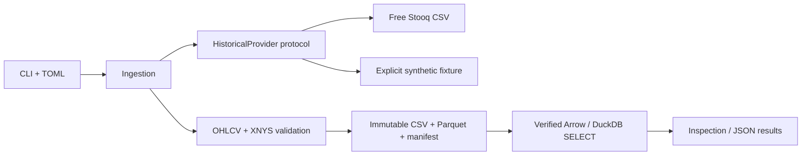

# Architecture and next steps

Adapters return bytes and provenance. Validation owns normalization and the daily
session contract. Ingestion owns cache/revision policy; storage owns atomic
publication and integrity. Future research code consumes normalized data without
importing vendor adapters. Broker execution and dashboard code remain independent.

Only implemented modules are present; future packages will accompany working
behavior rather than placeholder classes. Runtime data and environments are
ignored; manifests, lockfile, configuration, tests and docs are versioned.
Offline tests exercise the full fixture pipeline plus mocked HTTP errors,
calendar edge cases, corruption detection, caching, incremental snapshots,
configuration, JSON logging and CLI results. They do not claim market-data
availability or trading performance.

Next implement Milestone 2: event-driven replay, cash/position accounting,
commissions, spread/slippage, next-eligible-bar fills and deterministic timing
and accounting tests. Add momentum and mean-reversion examples only after those
contracts work. Meaningful financial evaluation also needs corporate actions,
verified execution prices, historical universe/lifecycle data and point-in-time
controls. No live broker functionality is enabled.

Milestone 3 then introduces causal features, forward labels, chronological/purged
splits and baseline regressions. Optimization, allocation, futures, paper trading,
dashboard, AI assistance and controlled live execution follow separately.
