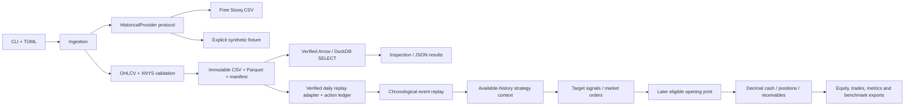

# Architecture and next steps

Adapters return bytes and provenance. Validation owns normalization and the daily
session contract. Ingestion owns cache/revision policy; storage owns atomic
publication and integrity. Future research code consumes normalized data without
importing vendor adapters. Broker execution and dashboard code remain independent.

Only implemented modules are present; future packages will accompany working
behavior rather than placeholder classes. Runtime data and environments are
ignored; manifests, lockfile, configuration, tests and docs are versioned.
Offline tests exercise the full fixture pipeline plus mocked HTTP errors,
calendar edge cases, corruption detection, caching, incremental snapshots,
configuration, JSON logging and CLI results. They do not claim market-data
availability or trading performance.

Milestone 2 now adds a daily-equity replay adapter, event queue, target signals,
market orders, opening-print cost model, independent decimal cash/position/action
ledger, baseline strategies and atomic reports. See the [architecture audit](architecture-audit.md)
for concrete decisions and the [backtesting guide](backtesting.md) for timing,
corporate-action contracts, numerical checks and limitations. Unadjusted price
semantics and action completeness are caller assertions, not vendor certification.
Historical universe/lifecycle data and true point-in-time publication remain missing.
No live broker functionality is enabled.

Milestone 3 is awaiting user review/instruction. It introduces causal features,
forward labels, chronological/purged splits and baseline regressions. The updated
[11-milestone roadmap](progress.md) schedules statistical validation explicitly;
basic timing safeguards are already implemented in the replay engine.
