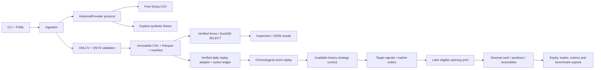

# Architecture and next steps

Adapters return bytes and provenance. Validation owns normalization and the daily
session contract. Ingestion owns cache/revision policy; storage owns atomic
publication and integrity. Future research code consumes normalized data without
importing vendor adapters. Broker execution and dashboard code remain independent.

Only implemented modules are present; future packages will accompany working
behavior rather than placeholder classes. Runtime data and environments are
ignored; manifests, lockfile, configuration, tests and docs are versioned.
Offline tests exercise the full fixture pipeline plus mocked HTTP errors,
calendar edge cases, corruption detection, caching, incremental snapshots,
configuration, JSON logging and CLI results. They do not claim market-data
availability or trading performance.

Milestone 2 now adds a daily-equity replay adapter, event queue, target signals,
market orders, opening-print cost model, independent decimal cash/position/action
ledger, baseline strategies and atomic reports. See the [architecture audit](architecture-audit.md)
for concrete decisions and the [backtesting guide](backtesting.md) for timing,
corporate-action contracts, numerical checks and limitations. Unadjusted price
semantics and action completeness are caller assertions, not vendor certification.
Historical universe/lifecycle data and true point-in-time publication remain missing.
No live broker functionality is enabled.

Milestone 3 now supplies causal features, execution-aligned labels, purged
walk-forward folds, five CPU model families and OOS ranking portfolios. The
concrete replay extension is synchronized `MarketData`, with per-symbol history,
one cash account and sell-before-buy opening batches. Single-stock APIs remain
supported. See [ML research](ml-research.md) for the model/data contracts and
evidence. The updated [11-milestone roadmap](progress.md) still schedules advanced
statistical validation explicitly; baseline timing safeguards are enforced now.

Milestone 4 provides automated bounded search and local MLflow tracking. Broker
execution and unrestricted research agents remain unimplemented.

## Milestone 4 discovery

`discovery/` adds bounded configuration, sealed development-only data, transactional
experiment identities/attempts, local MLflow tracking, persistent Optuna searches,
resource-limited subprocess workers, eligibility scoring, separate robustness
variants and reports. The parent excludes final holdout data before launching
workers. Existing ML and execution modules remain the evaluation foundation.
The LEAN provider supports an explicitly incomplete factor-file alternative with
unknown distribution payment dates. See [discovery](discovery.md) for boundaries.

## Milestone 5 statistical validation

`statistical/` builds on existing sealed data and resource-limited discovery
workers. Its config, interval checks, holdout ledger, statistical methods,
validation pipeline and CLI maintain distinct training/search/selection/final
roles. Fresh verified inputs must end before the reserved cutoff. Immutable
reports contain complete recorded search scope, fold metrics, uncertainty,
multiple-testing sensitivity, robustness lineage and conservative statuses.
No final evaluator is invoked and no brokerage execution is added. See the
[methodology](statistical-validation.md) and [pipeline audit](statistical-validation-audit.md).

## Milestone 6 portfolios

`portfolio/` adds past-only allocation, contract-aware sizing helpers, risk limits,
virtual strategy claims and shared-account orchestration. Optional replay hooks
observe actions/fills/closes and check opening risk; original strategy defaults
remain unchanged. Cash/quantities/receivables/equity reconcile to one authoritative
account. No live adapter or futures cash accounting is introduced here. See
[portfolio design](portfolio.md) for netting, ownership, limits and explicit
suspension/one-time stress-cap policies.

## Operational extensions (Milestones 7–11)

`futures/` adds actual-contract calendars/accounting, causal intraday features and
bounded supervised research. `paper/` adds normalized quote transports, one funded
equity/futures virtual account, conservative fills, durable orders, risk and restart
reconciliation. `web/` plus `dashboard/` expose curated artifacts and role-checked
paper/research controls. `agent/` validates structured proposals against independent
data/resource/holdout policies and records bounded experiments in durable memory.
`execution/` adds broker-independent sandbox control, the official Alpaca PAPER
adapter, signed scope, uncertainty recovery and reconciliation. LIVE is disabled.

No component turns a research finding into deployment authorization. Generated
code cannot execute. Broker credentials are excluded from research workers and
frontend clients. Canonical holdout ledgers are not exposed for evaluation through
the agent/dashboard. See the [operator readiness report](go-live-readiness.md)
for scientific and external operational limits that remain unresolved.
