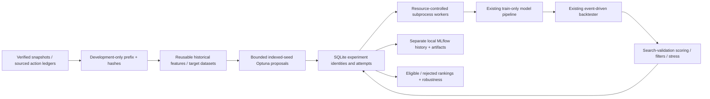

# Milestone 4: bounded strategy discovery

The full [Milestone 4 request](milestone-4-instructions.md) and the subsequent
[real-data requirements](milestone-4-data-instructions.md) are retained. Discovery
reuses the data, causal features, model interfaces, purged folds, target signals,
shared-cash backtester and metrics from Milestones 1–3. It does not implement live
execution, unrestricted research agents or Milestone 5 statistical certification.

## Install and run a real historical example

```bash
export UV_CACHE_DIR=/workspace/.cache/uv  # managed cloud; optional elsewhere
uv sync --frozen --all-extras
uv run --frozen --all-extras python examples/discovery_demo.py --allow-factor-proxy
```

The default demonstration downloads **real archived** QuantConnect LEAN daily bars,
matching factor files and an independent archived AAPL price reference. It imports
immutable snapshots, writes research/study YAML, runs four Optuna trials with two
bounded CPU workers, records MLflow runs and produces rankings and robustness
reports. It makes no synthetic fallback. `--synthetic` explicitly selects test
fixtures instead; use that only for software validation.

Defaults: input directory `data/discovery-real-inputs`, registry/study root
`data/discovery/real-demo`, four trials, two workers. Override `--data-dir`, `--root`,
`--trials` and `--workers` as needed before starting. Existing study roots are not
replaced. Verified existing imports reuse their snapshot IDs; changed inputs,
ledgers or source artifacts fail verification and are never silently overwritten.
Use a fresh input directory for different coverage or unverified partial imports.

The real archive contains fewer suitable distinct stocks than requested. The
selected universe is **AAPL, AIG, BAC, FB, GOOGL, IBM, WM, plus SPY**: seven stocks
across technology, financials, communications and industrials. Available complete
calendar coverage is **2014-04-03 through 2019-12-31**, 1,447 sessions per symbol,
more than five years. Several other liquid-company archives are absent; NWSA has
only two daily rows, and other files lack matching factors or introduce duplicate
share classes. The code does not fill missing symbols with invented data or call
ETFs additional stocks to reach a preferred count.

The final **2019-01-02 through 2019-12-31** range is reserved. Trial workers cannot
load those rows through the discovery pipeline. Discovery runs on the earlier
prefix, with 504 initial training sessions, 126 inner-validation sessions and
126-session search-validation windows, label purging and one-session embargo.

The actual executed configuration, snapshots, source hashes and results are linked
in [the recorded real-data run](milestone-4-results.md). Fresh downloads create new
snapshot ingestion IDs; the pinned source files and transformations remain
reproducible. Exact reruns use the retained immutable input IDs/seals.

## Real-data verification and the factor-file alternative

Data is pinned to QuantConnect/Lean commit
`655ac6d475ad8539ff54583a26327e63b59c5703` on GitHub. The repository documents New
York daily timestamps and prices in deci-cents; the adapter divides OHLC by 10,000.
Its reader applies normalization separately. Raw Apple price discontinuity at
2014-06-09 matches the factor file's 7-for-1 split. Every imported price series
passes the existing OHLCV/duplicate/missing-session/XNYS checks.

An independent, pinned Plotly archive of Yahoo AAPL quotes overlaps 506 sessions:
median close difference approximately $0.000002; 99.8% of closes are within one
cent. This checks AAPL price levels, **not** all symbols or all corporate events.
All downloaded ZIPs, factor files, normalized source CSVs, hashes and the reference
file are retained under the input directory. Dataset identifiers and coverage are
recorded in [the dataset manifest](milestone-4-datasets.json).

Factor files bracket the selected interval, and every supplied change in that
interval is converted using LEAN's documented algorithm:

- Effective date is the next XNYS trading session after the factor-row date.
- New shares per old share = next split factor / current split factor. Rounded
  factors are mapped to a nearby simple rational only within a 0.01% tolerance;
  available raw before/after price jumps must be consistent with that split.
- Cash-equivalent distribution = reference price × (1 − current price factor /
  next price factor), retained to six decimal places. These are approximate
  factor-derived distributions, not independently obtained dividend notices.

**This is not a complete, independently verified corporate-action ledger.**
The archive does not provide actual payment dates or certify every event type.
Non-cash distributions may be represented as cash-equivalent factor changes.
The explicitly enabled `factor_file_proxy` method sets `complete: false`, carries
limitations into reports, and preserves unknown payment dates as JSON null.
Distributions accrue to ex-date holders as receivables and remain unspendable;
no invented pay date or cash credit is added. Consequently dividend reinvestment
and cash availability are conservative approximations. Existing complete-event
ledgers retain their previous behavior; other incomplete ledgers are still rejected.

The example requires `--allow-factor-proxy` to acknowledge that alternative. It
must not be described as fully corporate-action-aware, unbiased or certified
point-in-time. These are archived sample/test datasets, not a production market
feed; source revisions, historical membership, delistings and other lifecycle
coverage are not certified. The stock selection is static and survivor-prone.
QuantConnect's data documentation credits AlgoSeek/QuantQuote and reserves data
rights; raw downloaded files are ignored by Git and are not redistributed here.

## Architecture and durable identities



`discovery/config.py` defines bounded spaces, resources, score weights and heuristic
eligibility policies. `data.py` materializes/caches development data. `registry.py`
owns transactional identities/attempts. `engine.py` supervises subprocesses;
`worker.py` applies limits before ML imports. `evaluation.py` uses existing models
and replay. `study.py` owns Optuna ask/tell and resume. MLflow tracking, reports
and robustness each have separate adapters. No distributed service is required.

An experiment ID hashes its full definition, source-code hash, dataset seal,
hypothesis, selected groups/target/horizon, model parameters, seed, training windows,
execution costs, ranking rules and evaluation policy. Git commit metadata is also
recorded; the source hash is authoritative for uncommitted code. Each execution or
explicit reproduction receives a distinct attempt ID and directory. `BEGIN
IMMEDIATE` claims prevent simultaneous duplicate executions. Completed duplicate
configurations reuse their existing result and are marked as duplicates in trial
history; they are not counted as new independent evidence.

Failed attempts retain their reason, worker log, resource record, partial artifacts
and MLflow linkage. Retries are bounded by `max_attempts`. Exact reproduction
requires the recorded source code and immutable inputs. Original attempt outputs
are never rewritten. SQLite transactions/WAL support this local-worker design;
one study controller owns a root at a time. Different studies should use separate
roots so scores from incompatible policies/periods are not mixed.

## Search-space configuration

`examples/discovery_demo.py` writes fully populated `discovery-research.yaml` and
`discovery-study.yaml` files. See `configs/discovery.example.yaml` for the schema.
The study references an existing M3 research YAML for source snapshots, action
ledgers, universe, base features/windows, costs, cash and risk constraints.

Each feature-set name explicitly lists any combination of momentum, mean reversion,
volatility, volume, market regime, technical and relative-strength groups. Features
are selected only from the calculated feature whitelist; targets and future timing
columns cannot enter models. Full causal features are cached once per data/code/
feature-policy seal and reused by model, group and target trials.

Targets are `stock_return`, `excess_return`, positive-excess `direction`, and future
`volatility`, at horizons 1, 5 or 10 sessions. Return labels retain M3's next-eligible
open-to-future-open total-return definition. Volatility is annualized RMS future
one-session open-to-open log total returns. Its forecasts rank lower values first;
classification ranks probabilities. Volatility directional accuracy is undefined,
not presented as meaningful performance.

Ridge is regression-only; logistic is classification-only. Random Forest, LightGBM
and XGBoost support both. Conditional model parameters have stable names by target
and model. Library-invalid parameter values become retained failed trials. Only
finite bounded int/float/categorical distributions are accepted; there is no eval,
arbitrary Python expression, plugin import or unbounded feature-combination generator.
CPU/task/seed overrides remain controlled by ModelSpec.

Ranking choices include top N, directed score thresholds by target, historical-vol
adjusted scores, equal/inverse-volatility target weights, rebalance sessions,
position-weight/cash constraints and regime filtering. Capped inverse-vol weights
are not redistributed after clipping; remaining wealth stays unallocated. Weights
are signal-time targets, not continuous post-gap exposure guarantees. Existing
long-only cash constraints reject unaffordable opening fills; no leverage is added.

## Validation and holdout isolation

Only the preparation stage opens original snapshots to verify and trim them.
It creates a separate `sealed/<id>/` tree containing pre-holdout CSV/Parquet,
pre-holdout action records and cached datasets/features. Workers receive only
those paths and checksums, not the original snapshot-store path. All files are
verified before each job. Raw holdout rows and holdout labels are absent. Data,
cutoff and code policy are immutable for a resumed study and cannot be searched.
The normal M3 dataset builder remains strict; its discovery-only mode accepts
only the explicitly marked trimmed provider and rejects any holdout row.

This is an enforced data-access contract for the fixed declarative pipeline,
not an OS sandbox against arbitrary hostile Python. There are no custom worker
callbacks or holdout-evaluation commands. Future research agents need stronger
OS/credential isolation. No final holdout evaluation has been authorized or run.

Candidates share the longest configured horizon's usable dates and boundary-label
calendar, so horizon comparisons do not gain extra trading days from shorter
labels. Training labels mature before inner validation. Inner-validation labels
mature before search-validation. Labels are also purged between search-validation
windows. Returns are still temporally dependent; disjoint windows do not establish
statistical independence. Training-only scaling is retained. Models use only
past training data, but hyperparameters are selected using repeated validation,
so these results are never called independent final tests.

Reports separate `in_sample`, `inner_validation` and `search_validation` predictive
metrics. No holdout performance is synthesized. Multiple-testing and selection-bias
warnings accompany every ranking. Failed/discarded Optuna trials, duplicate links,
resource failures and candidate rejections remain visible.

## Objective and eligibility

The documented scalar score is:

```text
+ excess_return_weight × mean window net excess return over SPY
+ predictive_skill_weight × mean clipped predictive skill
+ sharpe_weight × mean tanh(Sharpe / 3)
− drawdown_weight × worst absolute window drawdown
− turnover_weight × mean gross turnover
− costs_weight × mean costs / initial capital
− instability_weight × std(window excess returns)
```

Predictive skill is 1 − MSE / naive-baseline MSE, clipped to [-1,1]. The naive
baseline is zero return/volatility or probability 0.5. Configurations must retain
predictive, drawdown, turnover and cost terms; exclusive return/Sharpe optimization
is not supported. Rejected candidates receive a separate objective penalty, while
reports retain their unpenalized score and every score term. Never promote Optuna's
`best_trial` without checking eligibility and robustness.

Heuristic filters cover minimum validation windows/fills/exits, worst drawdown,
turnover, excess-return variation, fraction of positive SPY-relative windows,
mean SPY excess, mean excess over the strongest simple comparator, cost sensitivity
and the largest exit fill's share of positive realized exit P&L. Thresholds are
configurable policy choices, not scientifically established cutoffs. Exit concentration
does not measure dependence of unrealized or dividend P&L; those limitations remain.
The framework can reject every candidate.

All trials use SPY, seeded random rankings, positive momentum, mean reversion and
equal-weight comparisons on their same trading windows. Cost stress replays fixed
forecasts under doubled (or other bounded) commissions, minimum fees, spread and
slippage; it does not retrain or alter the original backtest. Windows start with
fresh capital; reported mean window returns are not one continuous multi-year CAGR.

## Optuna, MLflow, resources and recovery

Proposals use Optuna RandomSampler with seed = study seed + persistent trial number.
Proposals are made centrally and results told in trial order. This is reproducible
bounded random optimization, **not TPE**; it avoids completion-order-dependent
parallel suggestions and does not need an unpersisted sampler RNG to resume.
`optuna.sqlite` stores optimization state. Optional ThresholdPruner acts only after
at least two completed validation windows and before the final window; worker/
controller acknowledgements enforce the boundary. Pruning is a configurable
operational heuristic, not a significance test. Default pruning is disabled.

`registry.sqlite` stores definitions, attempts, states and stable trial links.
`mlflow.sqlite` and `mlflow-artifacts/` store the separate tracking history, linked
by experiment/attempt/trial/run IDs. MLflow records code/data identity, hypotheses,
model/strategy/cost parameters, seeds/windows, metrics, predictions, models,
backtests, configurations, errors and status. No remote MLflow server or credentials
are required; local tracking URIs are explicit, so inherited remote settings do not
receive experiment data. No UI process is needed to run experiments.

Each worker has configurable CPU affinity/thread settings, Linux RLIMIT_CPU,
RLIMIT_AS and sampled parent RSS monitoring. Wall limits terminate the process group.
The supported scientific-worker admission minimum is 512 MiB; smaller requested
caps produce a recorded MEMORY_LIMIT before importing native libraries. Larger
budgets can still be insufficient for a job. CPU and memory limits concern worker
computation; parent preparation/tracking/report I/O is not a kernel-isolated job.
The total active study wall budget stops scheduling and cancels worker computation;
cleanup/logging may finish after it. Trial counts include failed/pruned/duplicate
trials and persist across resumes. Robustness also shares the remaining wall budget.
Batch candidates not started within budget are recorded as NOT_RUN_BUDGET rather
than silently dropped. GPU assignment is explicitly rejected by the CPU-only models.

Dead owners are detected using PID plus creation time; only matching managed
children are terminated during recovery. Interrupted attempts remain in history.
Orphan Optuna trials are marked failed, and remaining trial budget can continue.
Resume restarts jobs, not partially fitted estimator internals. Exact reproduction
or bounded retry can rerun the recorded definition. Tracking failures preserve local
results and remain ineligible until recovered/retried successfully.

## CLI and robustness

```bash
# One configured candidate, optionally with a flat fixed-parameter YAML
uv run --all-extras quantlab discovery run --study STUDY.yaml --root ROOT
uv run --all-extras quantlab discovery run --study STUDY.yaml --root ROOT --parameters PARAMS.yaml
# Explicit batch, bounded by max_trials and worker count
uv run --all-extras quantlab discovery batch --study STUDY.yaml --root ROOT --parameters A.yaml B.yaml
# Optimize, resume, inspect and reproduce
uv run --all-extras quantlab discovery study --study STUDY.yaml --root ROOT
uv run --all-extras quantlab discovery resume --study STUDY.yaml --root ROOT
uv run --all-extras quantlab discovery list --root ROOT
uv run --all-extras quantlab discovery compare --root ROOT
uv run --all-extras quantlab discovery rejected --root ROOT
uv run --all-extras quantlab discovery reproduce ATTEMPT_ID --study STUDY.yaml --root ROOT
uv run --all-extras quantlab discovery report --root ROOT
```

Use different roots for unrelated studies; `run` and `batch` are independent manual
executions with their own invocation budgets, not ways to extend an exhausted Optuna
study budget. Resume requires unchanged study/data/code policy. The fixed-parameter
schema uses the exact Optuna parameter names in recorded trial histories; unknown,
unused or out-of-bound fixed values fail before execution.

Promising candidates get bounded, separate robustness attempts for alternative
training/validation periods, nearby numeric parameters within declared search
bounds, sizing and regime variants. Cost stress is already present in every window.
Market-environment summaries separate SPY-up/down windows. Declared universe subsets
can be tested, but reliable historical membership is absent and static subsets are
labeled diagnostic rather than unbiased universe robustness. All variants are
counted as additional hypotheses. Original result bytes remain unchanged. With no
eligible candidates, the example explicitly permits robustness of a rejected
candidate **for diagnostics only**; this never promotes it. Reports show unrun
variants when budget is exhausted and do not equate missing checks with passing.

Outputs include `reports/study.json`, `ranking.json`, `ranking.md`,
`robustness.json`, per-attempt definitions/resource/failure records and complete
window-level prediction/model/equity/drawdown/trade/position/cost artifacts. Top-level
ranking JSON retains full configurations, selected features, window comparisons,
action limitations and trial history.

## Verification and Milestone 5

Tests cover bounds, deterministic proposals, compatibility, duplicate claims,
interrupted-state recovery, Optuna persistence/pruning/resume, MLflow artifacts,
training/label chronology, physical holdout absence, seal tampering, shared horizon
calendars, score/filter explanations, robustness bounds, resource enforcement,
tracking recovery, explicit budget skips and preservation of modified source files.
Tests use deterministic invented fixtures; the separate documented demonstration
uses the actual historical archive described above.

Milestone 5 is not started. It must expand selection-aware statistical validation,
multiple-testing controls, robust uncertainty estimates and independent final
holdout authorization/evaluation. Production research also needs stronger source
certification, exact corporate-event/payment data, reliable historical universes,
broader regimes, scalable cache/catalog storage and stronger job isolation.
