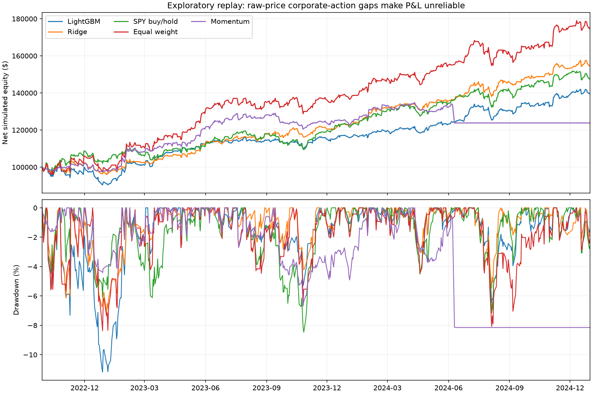

# First end-to-end ML trading experiment

**Completed as an exploratory experiment. Profitability is NOT validated.**

Raw prices and a fixed present-day stock list lack complete corporate-action and point-in-time membership evidence. Unexplained gaps are retained and prominently flagged, not converted into guessed splits. Numerical P&L below can be distorted and must not establish a trading edge.

## Executed configuration

- Input history: 2020-01-01 through 2024-12-31; actual sessions 2020-01-02 through 2024-12-31.
- Alpaca SIP raw one-minute bars aggregated over XNYS regular sessions; 11 symbols × 1,258 sessions = 13,838 real daily observations.
- Universe: SPY benchmark; AAPL, MSFT, AMZN, GOOGL, META, NVDA, TSLA, JPM, XOM and UNH stocks.
- Models: LightGBM (50 estimators, max depth 4) and Ridge (existing default parameters), seed 42, CPU only.
- Existing features: momentum/returns, volatility, relative volume, moving averages, relative strength and SPY market context; full definitions in training-report.json.
- Target: five-session next-eligible-open to horizon-open excess quoted price change over SPY; not certified total return.
- Rolling 504-session training / 126-session validation / 126-session evaluation windows, five-session embargo and label purging. Preprocessing is fitted on training data only.
- Evaluation replay: **2022-09-28 through 2024-12-31**; identical dates for both models and benchmarks.
- $100,000 starting simulated cash; up to 10 positively predicted, liquidity-eligible stocks; equal-sized targets capped at 8% each, 20% cash reserve, whole shares, long-only, no borrowing.
- Rebalance every five trading sessions (weekly cadence, not fixed Mondays); holding timeout 20 sessions; maximum drawdown 20%, daily loss limit 5%.
- Signal uses available close-bar features; fill is the next eligible open. Terminal positions are liquidated with costs.
- Baseline costs: $0.005/share commission, 2 bps full spread, 5 bps slippage, 1 bp market impact; low/high scenarios multiply costs by 0.5/2.

## Actual baseline-cost results

All figures are exploratory simulated raw-price replays, not reliable action-corrected profitability.

| Strategy | Start | End | Net return | Annualized | Volatility | Sharpe | Sortino | Max drawdown |
| --- | ---: | ---: | ---: | ---: | ---: | ---: | ---: | ---: |
| LightGBM | $100,000 | $139,908.30 | 39.91% | 16.07% | 11.69% | 1.33 | 2.06 | -11.18% |
| Ridge | $100,000 | $154,811.72 | 54.81% | 21.40% | 10.94% | 1.83 | 2.94 | -7.16% |
| SPY buy/hold | $100,000 | $147,819.29 | 47.82% | 18.93% | 12.01% | 1.50 | 2.31 | -8.47% |
| Equal weight | $100,000 | $175,173.30 | 75.17% | 28.24% | 15.33% | 1.70 | 2.73 | -8.37% |
| Momentum | $100,000 | $123,804.90 | 23.80% | 9.94% | 10.05% | 0.99 | 1.40 | -8.15% |
| Cash | $100,000 | $100,000.00 | 0.00% | 0.00% | 0.00% | undefined | undefined | 0.00% |

| Strategy | Win rate | Profit factor | Fills / exit fills | Costs | Two-way turnover | Avg gross exposure | Excess over SPY |
| --- | ---: | ---: | ---: | ---: | ---: | ---: | ---: |
| LightGBM | 71.10% | 1.79 | 769 / 391 | $3,098.67 | 36.70× | 49.10% | -7.91% |
| Ridge | 76.53% | 2.39 | 769 / 409 | $3,340.55 | 37.31× | 47.94% | 6.99% |
| SPY buy/hold | 100.00% | undefined | 2 / 1 | $146.14 | 1.68× | 82.29% | 0.00% |
| Equal weight | 75.99% | 2.35 | 1102 / 558 | $3,849.54 | 38.63× | 66.58% | 27.35% |
| Momentum | 71.48% | 1.64 | 487 / 270 | $2,062.19 | 23.63× | 31.47% | -24.01% |
| Cash | undefined | undefined | 0 / 0 | $0.00 | 0.00× | 0.00% | -47.82% |

Win rate and profit factor describe sell fills, including partial exits, not independently identified round trips. Turnover is two-way executed notional divided by mean equity over the whole evaluation period. Ratios use the engine's 252-session convention and zero risk-free rate; undefined ratios remain null.



## Cost sensitivity

| Model | Half baseline costs | Baseline costs | Double baseline costs |
| --- | ---: | ---: | ---: |
| lightgbm | 41.77% | 39.91% | 36.25% |
| ridge | 56.65% | 54.81% | 50.48% |

## Monthly and annual returns

All monthly and annual strategy returns are in [period-returns.csv](period-returns.csv). These compound net session returns over each observed period; first/last periods may be partial.

| Model | Year | Net return | Sessions |
| --- | --- | ---: | ---: |
| lightgbm | 2022 | -8.01% | 66 |
| lightgbm | 2023 | 27.06% | 250 |
| lightgbm | 2024 | 19.70% | 252 |
| ridge | 2022 | -2.56% | 66 |
| ridge | 2023 | 26.12% | 250 |
| ridge | 2024 | 25.98% | 252 |

## Evidence and limitations

- Training generated 11,920 labeled stock-session samples and 5 chronological folds per model. Saved fold models, feature definitions, dataset and out-of-sample predictions are retained.
- Saved prediction/model/dataset hashes and feature availability clocks were verified by the profitability worker before any simulation.
- Cash/equity and realized/unrealized-P&L identities reconciled in all 36 exported strategy/scenario ledgers within $0.00000001. Every terminal market value is zero; no negative cash balance occurred. See pipeline-verification.json.
- Nonzero fills, signals and commissions were verified for both ML strategies. Full trades, orders, signals, positions and corporate-action event logs are retained in each backtest artifact directory.
- The corporate-action logs do not certify that no events occurred. Evidence is incomplete: missing splits/dividends are UNKNOWN and no events are fabricated.
- Baseline comparisons share date bounds, starting cash, 20% cash reserve and execution/cost assumptions. SPY/equal-weight references intentionally disable stock concentration and drawdown stops; realized exposure and risk therefore differ. See exposure comparisons before interpreting excess return.
- The current stock list introduces survivorship/selection bias. These are chronological out-of-sample predictions within an exploratory development dataset, not an untouched final-holdout test.
- **2019 and 2025 onward were neither requested nor read as market-data payloads. No final holdout was consumed; no live trading was enabled.**

### Unexplained gaps in the evaluated period

**lightgbm**:
- NVDA 2024-06-10: unexplained raw-price gap of -90.0%. Possible missing corporate action; no split or dividend was inferred. Simulated profit/loss is unreliable until event evidence is supplied.
**ridge**:
- NVDA 2024-06-10: unexplained raw-price gap of -90.0%. Possible missing corporate action; no split or dividend was inferred. Simulated profit/loss is unreliable until event evidence is supplied.

### Pipeline fixes and provider observations

- SIP credentials and coverage were verified through successful bounded API responses and complete validated datasets, not merely key presence. No claim is made about the subscription plan name or unlimited access.
- Initial parallel minute downloads hit the observed 200-request/minute limit. Failures were retained in logs; remaining requests were submitted sequentially with one-minute cooldowns. There was no feed fallback.
- The completeness check rejected META's missing FB-era history while symbol mapping was disabled. A real bounded probe returned zero 2020 bars with asof=- and a valid bar with asof=2024-12-31. The Alpaca adapter was corrected to anchor mappings to the request end date and its cache identity was versioned. No missing sessions were suppressed.
- JNJ was rejected because Alpaca lacked the 2022-03-08 session; UNH replaced it before training and was required to pass the same full-session validation. No JNJ gap was padded or ignored. Coverage-based selection adds another selection-bias limitation.
- The first five complete snapshots use the prior provider version; the remaining six use the corrected version. Per-snapshot mapping settings, response-page hashes, source hashes and normalized hashes are in data-audit.json. All are raw RTH prices, aligned and independently validated.

## Verification results

- Relevant feature/dataset/model, timing, corporate-action, accounting, report, exploratory-workflow and profitability tests: **121 passed**.
- Provider and storage validation tests after the mapping fix: **19 passed**; the final provider regression also passed after strengthening its provenance assertions.
- All **11,240** saved prediction rows passed causal-clock validation; each fold's training labels precede fitting and validation labels precede evaluation.
- **36** exported ledgers reconciled: maximum cash/market-value identity error $0; maximum realized/unrealized P&L identity error $0.00000000000000000000005. Commissions are already included in cost basis/P&L and are not subtracted twice.
- SPY, equal-weight, momentum, mean-reversion and cash benchmark metrics were exactly identical between the LightGBM and Ridge replays.
- Both real saved reports rendered in the local Backtests tab with their actual net returns and prominent data warnings. Both report ZIP downloads matched the retained file hashes.
- Complete training, validation and evaluation date ranges are saved in [fold-periods.csv](fold-periods.csv). Model/dependency versions are retained in the experiment archive's environment.json.

## Run it yourself

From the repository root, after `python build.py`, configure `APCA_API_KEY_ID` and `APCA_API_SECRET_KEY` in your environment. No broker or Quantlab role token is required for this local development recipe. If using `.env`, prefix the commands with `uv run --env-file .env --frozen --all-extras` instead of `.venv/bin/`.

The exact YAML consumed is [configs/first-e2e-experiment.yaml](../../configs/first-e2e-experiment.yaml). The example is a thin orchestrator: ingestion uses the existing `quantlab download` CLI; training and replay use the existing dashboard API and `quantlab.web.workflow_worker` CLI. It contains no feature, model, signal, accounting or metric implementation.

Actual server command used:

```bash
QUANTLAB_WORKFLOW_LIBRARY="$PWD/data/experiments/first-e2e-20261113/library" .venv/bin/quantlab dashboard --host 127.0.0.1 --port 8000
```

Actual ingestion command, run once for each configured symbol:

```bash
.venv/bin/quantlab --data-dir data/experiments/first-e2e-20261113/library download SPY --provider alpaca --alpaca-feed sip --start 2020-01-01 --end 2024-12-31
```

Actual training and backtest commands (rerunning creates new retained jobs):

```bash
.venv/bin/python examples/first_e2e_experiment.py --config configs/first-e2e-experiment.yaml --stage train
.venv/bin/python examples/first_e2e_experiment.py --config configs/first-e2e-experiment.yaml --stage backtest
```

For a new machine, the same recipe's `--stage download` runs the existing ingestion CLI for every symbol with cooldowns; `--stage all` runs the complete sequence. Start the local dashboard server before submitting training/backtests.

Open `http://127.0.0.1:8000/models` to view training, and `http://127.0.0.1:8000/backtests` to view the retained profitability jobs. The shared Cloud workspace holds the actual models and full ledgers; `git pull` alone transfers the recipe/report, not ignored `data/` artifacts. Download the experiment archive or rerun locally.

### Saved outputs

- Training job: `008c5902b2e445778a3ea37f7d26e07b`; artifacts: `data/dashboard/jobs/008c5902b2e445778a3ea37f7d26e07b/artifacts`.
- Models: `data/dashboard/jobs/008c5902b2e445778a3ea37f7d26e07b/artifacts/research/models/fold-*/{lightgbm,ridge}/model.joblib`, with manifests and preprocessing state.
- Predictions: `data/dashboard/jobs/008c5902b2e445778a3ea37f7d26e07b/artifacts/research/out_of_sample_predictions.parquet`; dataset, configuration and research report are alongside it.
- Original immutable data: `data/experiments/first-e2e-20261113/library/snapshots/`.
- Experiment run index, data audit, logs and verification: `data/experiments/first-e2e-20261113/`.
- This report, comparison CSV, monthly/annual returns, equity/drawdown plot, trade logs and complete report JSON files: `docs/first-e2e/`.
- Downloadable archive: `data/experiments/first-e2e-20261113/experiment-artifacts.zip`.

- lightgbm backtest job: `ad499bbe802745acb364c9dee18b9242`; report and scenario ledgers: `data/dashboard/jobs/ad499bbe802745acb364c9dee18b9242/artifacts/profitability`.
  Dashboard: `http://127.0.0.1:8000/backtests?job=ad499bbe802745acb364c9dee18b9242`.
- ridge backtest job: `ed893e5a4b4642beb34837b404157aad`; report and scenario ledgers: `data/dashboard/jobs/ed893e5a4b4642beb34837b404157aad/artifacts/profitability`.
  Dashboard: `http://127.0.0.1:8000/backtests?job=ed893e5a4b4642beb34837b404157aad`.

### Change the experiment

Edit the YAML's `training.models`, `symbols`, `history.start/end`, training/validation/evaluation session windows, or `backtest` buy threshold, holding/rebalance cadence, cash allocation, position cap, costs and risk limits. Keep SPY plus sufficient stocks for `top_n`; lower `top_n` when reducing the stock count. Download changed symbol/date ranges before retraining, then rerun backtests. The first-experiment recipe intentionally refuses 2019 and 2025 onward. Existing eight-fold, sample-budget, coverage, temporal-integrity and strict-evidence gates still apply. The exploratory feature set uses the current built-in FeatureConfig; its definitions are saved, and this recipe does not introduce a new feature framework.

**Conclusion:** The system completed acquisition → validation → features → LightGBM/Ridge fitting → causal OOS prediction → signals → costed event replay → reconciliation → reporting. Missing action and membership evidence prevents a trustworthy profitability conclusion or promotion, regardless of the numerical ranking above.
