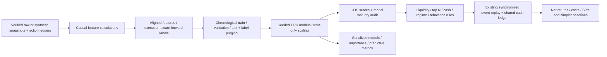

# Milestone 3: causal feature engineering and CPU machine learning

This implements a bounded, configured experiment, not automatic strategy discovery.
The full [Milestone 3 request](milestone-3-instructions.md) is preserved unchanged.
The existing snapshot pipeline, cash ledger, corporate actions, order/fill model,
cost model and single-instrument strategy interface remain supported.

## Run the complete example

From the checkout root (Python 3.12+, Linux x86_64 for the selected XGBoost CPU wheel):

```bash
export UV_CACHE_DIR=/workspace/.cache/uv  # managed cloud; optional elsewhere
uv sync --frozen --extra dev --extra ml
uv run --frozen --extra ml python examples/ml_research_demo.py
```

This creates 360 sessions of **invented**, seeded SPY/AAA/BBB/CCC OHLCV, stores
immutable snapshots through Milestone 1, and writes a fully populated YAML file
at `data/ml-demo-inputs/experiment.yaml`. It trains all five model families on CPU,
generates strictly out-of-sample forecasts, ranks stocks, and executes portfolios
through the event-driven cash/accounting engine. There are no network calls or
live orders. Default output: `data/research/milestone-3-demo`.

Use `--output data/research/another-run` to preserve prior reports. Reuse the
populated configuration through the CLI:

```bash
uv run --frozen --extra ml quantlab research \
  --experiment data/ml-demo-inputs/experiment.yaml \
  --output data/research/repeated-config-run
```

Output directories are published atomically and are never overwritten. Input demo
snapshots are new immutable revisions on each generation; model seeds and generated
price paths are fixed. To reproduce exactly the same input identifiers, reuse the
same saved YAML. Synthetic outcomes are software checks, not statistical evidence
or profitable historical trading results.

## Architecture



- `features/engine.py`: configured calculations, formulas and warmup policy.
- `ml/datasets.py`: split-aware histories, aligned supervised rows and total-return labels.
- `ml/validation.py`: expanding/rolling walk-forward folds with explicit overlap purging.
- `ml/models.py`: common fit/predict/evaluate/save/load interface.
- `ml/evaluation.py`: task-aware errors, rank IC and probability calibration.
- `strategies/ranking.py`: target quantities using only currently eligible prediction batches.
- `research/config.py`, `runner.py`: strict YAML, fixed model candidates, artifacts and reports.

The concrete backtesting extension is `MarketData`: multiple daily USD feeds with
identical sessions share the existing account. A session's opens/closes are grouped;
sells execute before buys, with order ID as a stable tie-breaker. Corporate actions
remain per instrument, with unique dividend entitlement identifiers. Read-only
contexts add available histories and observable prices by symbol. Single-stock
`DailyData`, `on_bar`, `Signal` and existing baseline classes still work. Position
histories are exported separately in `positions.csv`. Multi-asset allocation here
is limited to basic long-only ranking; full portfolio optimization remains Milestone 6.

## Feature definitions and missing values

Defaults use returns over 1, 3, 5, 10, 20 and 60 sessions; short/long windows 10/20;
ATR and RSI 14; MACD 12/26/9; and Bollinger window 20. All are configurable in YAML.
Feature names and exact formulas are exported with each dataset.

| Family | Features / convention |
| --- | --- |
| Price | Simple and log returns at each configured horizon; one-session log-return alias; long-window momentum; stock minus SPY momentum; short/long SMA distances and SMA ratio; rolling highest high/lowest low and distances from them. |
| Volatility | Sample log-return volatility, annualized by sqrt(252), at short/long windows; their ratio and one-session short-vol change; long-window downside RMS log-return volatility; simple average true range (not Wilder ATR). |
| Volume | Short/long volume SMAs, current volume relative to long SMA, dollar volume, mean dollar volume, short-window volume momentum. |
| Technical | Wilder RSI seeded with the initial window; SMA-seeded EMA MACD/signal/histogram; Bollinger middle/upper/lower bands at two population standard deviations, z-score and relative width; SMA crossover ratio. |
| Market/sector | Aligned SPY momentum, volatility and close/SMA trend; optional stock minus sector-ETF momentum when every stock has configured sector data. |

Features use only closes/bars published by the prediction timestamp. Histories are
cut at the feature session even if later-session data has already arrived; no future
price or action enters the prefix. Only splits already effective by prediction time
rebase past prices. Volume is rebased inversely to prices into current share units,
preserving historical dollar volume. This is distinct from the backtester's legacy
raw-volume history; research calculations explicitly own this transformation.
Cash dividends are not reinvested into price-feature histories.

Warmup is the maximum required by return, volatility, ATR, RSI, MACD and Bollinger
windows (61 bars by default). Incomplete/nonfinite rows are dropped, never filled
from future rows or cross-sectional statistics. Flat RSI is 50; gains without
losses give 100; flat Bollinger z-score is 0; two zero volatilities have neutral
ratio 1. Zero lagged volume makes volume momentum undefined and drops the sample.
No sector column is invented when sector snapshots are absent; partial mappings fail.

## Labels, timestamps and holdout protection

The default target is five-session **excess total return relative to SPY**. One
and ten sessions are also supported. For a feature session:

1. `prediction_at` is the latest required stock/SPY/sector daily-bar availability.
2. `execution_at` is the first common session open strictly after that timestamp.
3. `label_end_at` is the open exactly horizon sessions after entry.
4. Stock and SPY gross returns measure entry-open to exit-open wealth change,
   including splits and accrued cash dividends on shares owned between those opens.
   Ex-date purchases receive no dividend; ex-date sales keep entitlement. Costs are
   excluded from prediction labels and included in the trading simulation.
5. `label_known_at` is the later availability of the two required exit daily bars,
   conservatively waiting for source publication rather than assuming a label was
   available when the market printed the exit open.

`target` is stock return minus SPY return; `target_class` is 1 when excess is
strictly positive. The next-open definition differs deliberately from a
close-to-close label: it matches when a strategy can actually enter. Feature names
are an explicit whitelist, never inferred as all numeric columns; targets and
future metadata cannot accidentally enter the estimator.

`holdout_start` is mandatory and must lie within the supplied history. No holdout
feature rows, labels, model metrics or backtests are calculated. Labels whose exit
session enters the holdout are excluded before reading their price values. Input
snapshot integrity/schema checks still validate the files; that does not expose
holdout prices to fitting or scoring. The saved development dataset contains no
holdout target rows. Reports state `holdout.status: not_evaluated` and give the
reserved session count. Mutating holdout prices leaves the development dataset unchanged.

## Chronological evaluation

Windows use **session counts**, not approximate calendar years. Each fold has
training, subsequent validation and subsequent test blocks. Default demo windows
are 80/30/40. Training expands by default; `expanding: false` uses a rolling fixed
training window. Retraining occurs every `test_sessions`; test blocks do not overlap,
and the last block can be shorter.

Training labels must have `label_known_at < first validation prediction time`.
Validation labels must mature strictly before the first test prediction time.
An optional `embargo_sessions` additionally removes sessions at the training and
validation block ends. Rows removed by label-overlap purging are counted. All
features, scalers and estimators are fitted using training rows only. Validation
metrics are recorded, but no model/hyperparameter is selected using test results.
`primary_model` is fixed in the YAML before the run. Each OOS row records fold,
model, training-label maximum and model availability timestamp. These constraints
are checked again before ranking.

Model fitting is simulated as available at the validation boundary; actual training
latency is not simulated. With daily bars, production use would need retraining
completion/operational readiness checks. Historical price revisions, corporate-action
records and static ticker sets are not independently certified point-in-time.
Timing-safe code alone does not remove survivorship or revision bias.

## Models and predictive evaluation

`ResearchModel(ModelSpec(...))` supports `fit(frame, feature_names)`, `predict`,
`evaluate`, `importance`, `save` and `load`.

| Type | Tasks | Preprocessing |
| --- | --- | --- |
| ridge | Regression | Training-only StandardScaler |
| logistic | Classification | Training-only StandardScaler |
| random_forest | Regression or classification | No scaling |
| lightgbm | Regression or classification | No scaling; deterministic single CPU thread |
| xgboost | Regression or classification | CPU hist; one thread; official xgboost-cpu distribution |

All models have configured seeds and estimator hyperparameters; attempts to override
controlled CPU/task/seed settings through estimator parameters fail. Classification
predicts positive-excess **probability**, not an expected return; regression predicts
excess return. Both can rank stocks, but their MSE/MAE units differ. Classification
requires both classes in training. Repeated model types in one experiment are
rejected; use separate configurations to compare objectives for the same family.

Metrics include MSE, MAE, directional accuracy, mean per-session Spearman rank IC,
valid IC session count, and classifier reliability bins/Brier score. Constant or
single-stock cross sections have undefined IC, reported as null. Importance is
reported for trees; linear coefficients are signed coefficients on standardized
features. Metrics are provided by fold and aggregated across all OOS samples.
Overlapping OOS labels are dependent observations; no significance is inferred.

Each model artifact contains a joblib object plus feature schema, task, parameters,
seed, checksum and exact relevant dependency versions. Loading verifies checksum
and version compatibility. Only load trusted local joblib artifacts: checksums
are not authentication and do not make pickle deserialization a sandbox.

## Ranking, baselines and execution

At the configured rebalance interval, the strategy waits for the complete available
cross section and selects top N forecast scores among stocks meeting minimum trailing
average dollar volume. Positions target equal weights subject to maximum per-position
weight and cash reserve. Quantities are whole shares rounded down. Nonselected stocks
target zero. Optional SPY SMA-regime filtering sends the portfolio to cash.

`rebalance_sessions: 5` means every fifth available prediction session, not a fixed
weekday. The position cap is a **signal-time target**, not a continuously enforced
post-gap exposure limit; gaps and drift can change realized weights. Buys that cannot
be funded at actual opening prices plus fees are rejected by the existing cash ledger,
never levered. Rejections and unfilled/expired orders remain in the reports.

Comparators use the same data, OOS trading span and execution costs:

- Seeded random scores (date/symbol/seed hashes, no global RNG state).
- Positive-momentum top N.
- Oversold (negative SMA-distance) mean-reversion top N.
- Equal weight across all liquidity-eligible stocks, subject to the cap/cash rules.
- SPY buy-and-hold with the configured cash reserve; it is exempt from the stock
  per-position cap and has no regime filter or repeated rebalancing.

The stock comparators share rebalance/liquidity/regime rules. They are explicitly
cross-sectional baselines, distinct from the original single-stock M2 examples.
The trading span starts with the first OOS feature session and ends after the last
OOS signal's eligible entry session, before holdout. Predictive labels may mature
later within the pre-holdout development period. Final positions are marked, not
artificially liquidated. Classifier scores are ranked directly; they are not
misrepresented as forecast return amounts.

Reports explicitly state whether ML failed to exceed SPY or the strongest simpler
baseline after costs. A positive comparison is descriptive, not a statistical test.

## Configuration and real historical inputs

See `configs/ml-research.example.yaml`. Replace its snapshot identifiers and ledger
paths with actual imported, unadjusted stock and SPY data. Each real feed requires
Milestone 2's complete sourced action ledger. Unknown-adjustment Stooq snapshots
are still rejected as execution data, even if network access becomes available.
Only synthetic demo data was available for the integration runs in this environment;
no real-data trading performance has been verified.

Snapshot entries can be an ID for synthetic data or a mapping with `snapshot_id`
and `actions` for declared unadjusted data. `data_dir` and relative ledger paths
resolve against the YAML file. YAML is loaded safely and unknown fields fail.
`sectors: {AAPL: XLK, ...}` requires corresponding ETF snapshots and a mapping for
every universe ticker. SPY is the market benchmark in this first implementation.

Universe membership is the fixed provided ticker list. The system does not supply
historical constituent membership, delisting records or IPO-aware sparse panels.
Aligned complete sessions are required. Do not claim unbiased historical universe
performance from a present-day selection of surviving stocks.

## Artifacts, checks and next milestone

Outputs include a resolved, rerunnable `configuration.yaml`, the unchanged
`original_configuration.yaml`, development `dataset.parquet`,
`out_of_sample_predictions.parquet`, serialized `models/fold-N/type/`,
`research_report.json`, and each strategy's backtest folder with trades, orders,
signals, position/equity history, costs, SPY benchmark and integrity/provenance data.
The research report records data/config/prediction hashes, target definitions,
fold time boundaries, purged row counts, importance, predictive/trading metrics,
comparison conclusion, holdout status and limitations.

```bash
uv run --frozen --extra ml --extra dev pytest -q
uv run --frozen --extra ml --extra dev ruff check src tests examples
uv run --frozen --extra ml --extra dev ruff format --check src tests examples
uv build
```

Tests include numerical features, 1/5/10-day target alignment, splits/dividends,
source-availability timing, future/holdout mutation, chronological purging,
train-only scaling, all model/task combinations, serialization/inference,
seed reproducibility, cross-sectional ranking, cash/regime/liquidity limits,
rebalance scheduling, sell-funded buys and full repeated experiments.

Remaining limits include static survivor-prone universes, no independent source
certification, daily synchronized USD equities, complete in-memory histories,
full market fills and M2 execution assumptions, no calibrated return-to-probability
conversion, and no advanced significance/multiple-testing controls. Synthetic
results provide no evidence of a trading advantage. No live trading or GPU is enabled.

Milestone 4 has **not started**. Automated discovery will need controlled experiment
registries, hypothesis/variant accounting, Optuna budgets, MLflow tracking, dataset
and model lineage across runs, resource/job isolation, explicit selection rules,
and safeguards against repeatedly inspecting reserved holdouts.

## Recorded synthetic example output

The verified default example used four folds, 402 OOS stock/session samples per model,
46 features and a 50-session final holdout that was not evaluated. These prices
were invented for software validation; the following are not real market returns.

| Strategy | Simulated net total return | Fills |
| --- | ---: | ---: |
| ml | 3.4297% | 65 |
| spy_buy_hold | -0.4022% | 1 |
| random | 6.8052% | 66 |
| momentum | -4.5909% | 51 |
| mean_reversion | 5.7411% | 47 |
| equal_weight | 0.9845% | 76 |

Ridge OOS MSE: 0.00139957; MAE: 0.02904712; directional accuracy: 0.5199; mean session rank IC: 0.0410.

ML did not outperform the strongest simpler baseline after costs. No trading edge or statistical significance follows from these synthetic results.
